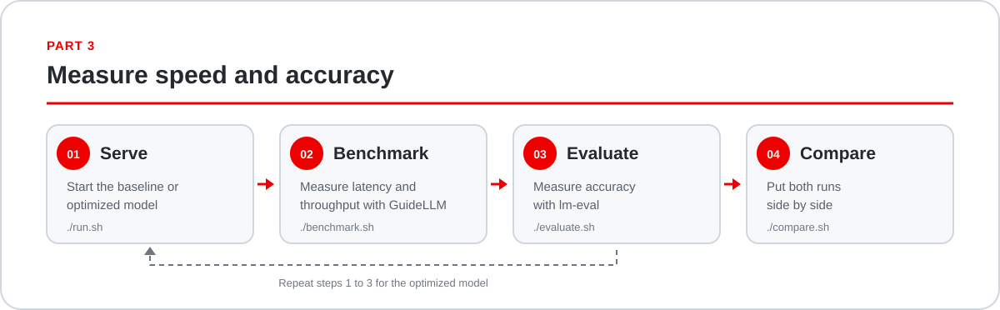
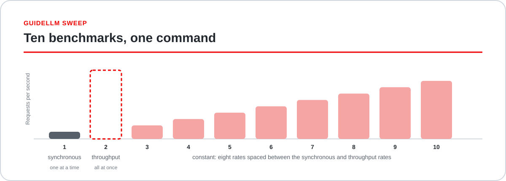

# vLLM Zero to Hero: Benchmark

### *This is part three in a three-part series with optional extra-credit lessons. Follow the vLLM-zero-to-hero [campaign path](https://github.com/red-hat-ai-dev/vLLM-zero-to-hero-overview) to learn more!*

Okay, so you've made your model smaller and faster. But how much faster is it, really? And did it get any worse at its job?

That's where benchmarking and evaluation come in! In this section, we're going to use GuideLLM to measure how fast a model serves requests and lm-eval to measure how accurate its answers are.

This is how the pipeline is going to look: you serve a model with vLLM, benchmark it with GuideLLM, evaluate it with lm-eval, repeat the same steps for the optimized model, and compare the results.

<p align="center">
  
</p>

Want to know what the scripts are doing? Read
[Behind the scenes](BEHIND_THE_SCENES.md).

See [tested support and validation](SUPPORT.md) for the exact platforms, versions, and remaining checks.

## What you will learn

- How to run a GuideLLM sweep against a live vLLM endpoint
- How to read latency and throughput statistics such as TTFT, ITL, and tokens per second
- How to run an lm-eval accuracy benchmark against the same endpoint
- How to read `exact_match` scores for the `strict-match` and `flexible-extract` filters
- How to compare a baseline model and an optimized model on speed and accuracy

This tutorial is designed for anyone interested in modern AI inference. You do not need to be a machine learning researcher or an inference specialist. The commands are copyable, and the explanations give you the context behind each step.

## The models used in this part

Part 3 uses the same Qwen3-4B pair as Part 2:

- **Baseline:** [Qwen/Qwen3-4B](https://huggingface.co/Qwen/Qwen3-4B)
- **Optimized:** [RedHatAI/Qwen3-4B-FP8-dynamic](https://huggingface.co/RedHatAI/Qwen3-4B-FP8-dynamic)

If you created your own FP8 checkpoint in Part 2, you can benchmark that one instead.

## Benchmarking, in plain language

A benchmark sends a controlled workload to a running server and measures what happens. [GuideLLM](https://github.com/vllm-project/guidellm) generates requests with a fixed prompt length and output length, sends them to the OpenAI-compatible API, and records the timing of every token that comes back.

The most important numbers are:

- **Time to first token (TTFT):** how long a user waits before the answer starts to appear.
- **Inter-token latency (ITL):** the time between each token after the first one. This is how smoothly the answer streams.
- **Request latency:** the total time from sending a request to receiving the last token.
- **Throughput:** how many requests and tokens per second the server completes.

Keep in mind that latency and throughput generally go against each other. (Ex. A server handling one request at a time answers quickly, but most of the hardware sits idle while a server handling many requests at once completes more work per second, but each user waits longer.)

This part uses GuideLLM's **sweep** profile to measure the whole range in one command:

<p align="center">
  
</p>

1. **Synchronous** sends one request at a time. This is the best-case latency for a single user.
2. **Throughput** sends as many requests as possible at once. This finds the server's maximum capacity.
3. **Constant** runs eight more benchmarks at fixed request rates spaced between the synchronous rate and the throughput rate. This shows how latency changes as load increases.

## Evaluation, in plain language

A faster model is only useful if it still gives good answers. Quantization can change a model's outputs, so after measuring speed we measure accuracy.

[lm-eval](https://github.com/EleutherAI/lm-evaluation-harness) (the Language Model Evaluation Harness) runs standard test sets against a model and scores the answers. This part uses **GSM8K**, a set of 1,319 grade-school math word problems. Each problem has a single numeric answer, so a response is either right or wrong.

lm-eval sends each problem to the same OpenAI-compatible API used for benchmarking. Before each problem, the prompt includes five solved examples (this is called 5-shot), so the model sees the expected answer format.

## Requirements

Every computer needs:

- Git and curl
- Python 3.10 through 3.13 for GuideLLM and lm-eval
- Internet access for the first setup and model downloads
- Enough memory and disk space for the baseline and optimized models, plus several GB for the benchmarking tools

The platform paths are:

| Platform | Baseline serving | Optimized serving | Benchmark and evaluation |
| --- | --- | --- | --- |
| Apple Silicon Mac | Native vLLM Metal with `mlx-community/Qwen3-4B-bf16` | Native vLLM Metal with `mlx-community/Qwen3-4B-4bit` | Local Python environment |
| Linux with NVIDIA | CUDA container | CUDA container; primary path for this part | Local Python environment |
| Linux with AMD | ROCm container | Try with the current vLLM ROCm support and verify locally | Local Python environment |
| Linux with Intel | XPU container | Try with the current vLLM XPU support and verify locally | Local Python environment |

The FP8 checkpoint from Part 2 does not run on vLLM Metal, so the Mac path compares the full-precision MLX model with a four-bit MLX model instead. On NVIDIA, FP8 runs at full speed on GPUs with compute capability 8.9 or newer, such as the L4, L40S, and H100. Ampere GPUs such as the A100 run it as weight-only FP8, so the speedup is smaller.

Linux container access must already work for the detected accelerator, the same as in Part 1. NVIDIA users also need
[NVIDIA Container Toolkit](https://docs.nvidia.com/datacenter/cloud-native/container-toolkit/latest/install-guide.html)
configured for Docker or Podman. Windows users can follow the Linux path from a compatible WSL2 environment.

## 1. Clone

```bash
git clone https://github.com/red-hat-ai-dev/vLLM-zero-to-hero-pt3.git
cd vLLM-zero-to-hero-pt3
```

## 2. Serve the baseline model

```bash
./run.sh baseline
```

The launcher detects macOS or Linux and chooses the same family of paths used in Part 1. On an Apple Silicon Mac, this starts the native vLLM Metal path. On Linux, it starts `Qwen/Qwen3-4B` in the matching accelerator container.

Success looks like this:

```text
vLLM is ready at http://127.0.0.1:8000/v1
```

Both models are served under the same name, `qwen3-4b`, so every command in this part works for either one.

## 3. Benchmark the baseline model

Keep vLLM running and use another terminal.

On Apple Silicon, set the tested concurrency cap in that terminal and keep it
for both the baseline and optimized benchmarks:

```bash
export MAX_CONCURRENCY=8
```

Then run the baseline benchmark:

```bash
./benchmark.sh baseline
```

The first run installs GuideLLM and lm-eval in a `.venv` folder inside this repository. Later runs reuse it.

The wrapper uses these GuideLLM settings (shown with standalone output paths):

```bash
guidellm run \
  --backend kind=openai_http,target=http://127.0.0.1:8000,model=qwen3-4b \
  --profile "kind=sweep,max_concurrency=${MAX_CONCURRENCY:-512}" \
  --constraint kind=max_duration,seconds=30 \
  --data kind=synthetic_text,prompt_tokens=256,output_tokens=128 \
  --tokenizer kind=huggingface_auto,model=Qwen/Qwen3-4B \
  --output kind=json,path=results/benchmark-baseline.json \
  --output kind=html,path=results/benchmark-baseline.html
```

The adaptive sweep targets up to 10 benchmarks at 30 seconds each, plus setup, warmup, and shutdown time. It may stop earlier when a measured rate is invalid or a stopping constraint is reached. When it finishes, the results are saved in the `results/` folder:

- `benchmark-baseline.latest/benchmark.json`: every statistic, for reloading and comparing
- `benchmark-baseline.latest/benchmark.html`: a self-contained report with charts. Open it in a browser.
- `benchmark-baseline.latest/benchmark.log`: the tables printed to the terminal

### What we are seeing

GuideLLM prints one table per group of metrics. Each table has one row per benchmark in the sweep: `synchronous`, `throughput`, and eight `constant` rows ordered from the lowest request rate to the highest. `Mdn` is the median and `p95` is the 95th percentile, the value that 95 percent of requests stayed under.

| Table | What it shows |
| --- | --- |
| Run Summary Info | When each benchmark ran and how many tokens were completed (`Comp`), incomplete (`Inc`), or errored (`Err`) |
| Text Metrics Statistics | Tokens, words, and characters per request and per second, for the input and the output |
| Request Token Statistics | The prompt and output length of each request. This confirms the workload was about 256 tokens in and 128 tokens out. |
| Request Latency Statistics | How long each request took. This is the user's experience. |
| Server Throughput Statistics | How much work the server completed per second. This is the server's capacity. |

The two tables to focus on are the last two.

**Request Latency Statistics** has these columns:

- **Request Latency:** the total time for one request, in seconds.
- **TTFT:** time to first token, in milliseconds.
- **TTFOT:** time to first output token. It matches TTFT unless the model emits reasoning or tool-call tokens before its visible answer.
- **ITL:** inter-token latency, in milliseconds.
- **TPOT:** time per output token, including the first token, in milliseconds.

**Server Throughput Statistics** has these columns:

- **Concurrency:** how many requests were in progress at the same time.
- **Requests Per Sec:** how many requests completed per second.
- **Input, Output, and Total Tokens Per Sec:** how many tokens the server processed per second. Output tokens per second is the usual headline throughput number.

Read the tables from top to bottom. The `synchronous` row measures latency with one request at a time. The `throughput` row measures throughput under the configured concurrency cap. In the `constant` rows, the latency grows as the request rate rises. When completed requests per second stop keeping up with the target rate, the server is falling behind for that workload.

The terminal labels every rate-based row as `constant`. The target rate of each row is in the HTML report and the JSON file.

### What the options are

The script accepts a few settings as environment variables:

| Setting | Default | What it changes |
| --- | --- | --- |
| `MAX_SECONDS` | `30` | Measurement window for each strategy in the adaptive sweep |
| `MAX_CONCURRENCY` | `512` | Positive integer limiting concurrent requests in the throughput and constant-rate strategies |
| `PROMPT_TOKENS` | `256` | The length of each synthetic prompt |
| `OUTPUT_TOKENS` | `128` | The number of tokens generated for each request |
| `PORT` | `8000` | The port of the vLLM server |

For example, to simulate a workload with long documents and short answers:

```bash
PROMPT_TOKENS=2048 OUTPUT_TOKENS=64 ./benchmark.sh baseline
```

On a local machine, start with a bounded load and use the same settings for both
models. For example, to cap the sweep at eight concurrent requests:

```bash
MAX_CONCURRENCY=8 ./benchmark.sh baseline
MAX_CONCURRENCY=8 ./benchmark.sh optimized
```

Run each command while its corresponding model is serving. The concurrency cap
is saved in `run.json`; comparison rejects different caps or missing provenance
on one side. Both models need new runs when changing the cap. A zero-completion
strategy is still rejected. On the tested M4 Pro, the default 512-concurrency
BF16 throughput strategy completed no requests in either 10 or 30 seconds;
both models completed all ten strategies with the eight-request cap at 30
seconds per strategy. See [the support record](SUPPORT.md) for the tested scope.

GuideLLM itself is installed in `.venv/bin/guidellm`, so you can also run it directly. Every option uses the form `--<option> kind=<type>,key=value`. The main options are:

| Option | Choices |
| --- | --- |
| `--profile` | `sweep`, `synchronous`, `throughput`, `concurrent` (a fixed number of parallel users, set with `streams=`), `constant` (a fixed rate, set with `rate=`), and `poisson` (a random rate around `rate=`, closer to real traffic) |
| `--data` | `synthetic_text` for generated prompts, `huggingface` for a dataset from Hugging Face, or `json_file`, `csv_file`, and `text_file` for your own prompts |
| `--constraint` | `max_duration` or `max_requests` to limit each benchmark, `max_errors` to stop on failures, and `over_saturation` to stop when the server falls behind |
| `--output` | `json`, `yaml`, `csv`, `html`, and `plot` for a static chart image |
| `--config` | The built-in `chat` or `rag` scenario, or your own scenario file |

For example, to measure the experience of 1, 4, 16, and 64 simultaneous users:

```bash
.venv/bin/guidellm run \
  --backend kind=openai_http,target=http://127.0.0.1:8000,model=qwen3-4b \
  --profile kind=concurrent \
  --override profile.streams 1,4,16,64 \
  --constraint kind=max_duration,seconds=30 \
  --data kind=synthetic_text,prompt_tokens=256,output_tokens=128 \
  --tokenizer kind=huggingface_auto,model=Qwen/Qwen3-4B \
  --output kind=html,path=results/concurrency-baseline.html
```

Run `.venv/bin/guidellm run --help` for every option, or read the
[GuideLLM documentation](https://github.com/vllm-project/guidellm/tree/main/docs).

Each wrapper saves a separate run under `results/runs/`. The `.latest` link
changes only after the tool succeeds and its JSON is readable. Failed runs keep
their logs and earlier successful runs remain available. Direct tool commands
above write their own paths and do not use this protection.

## 4. Evaluate the baseline model

Keep the same server running:

```bash
./evaluate.sh baseline
```

The script runs this lm-eval command:

```bash
lm_eval \
  --model local-completions \
  --model_args model=qwen3-4b,base_url=http://127.0.0.1:8000/v1/completions,num_concurrent=8,max_retries=3,tokenized_requests=False,tokenizer=Qwen/Qwen3-4B \
  --tasks gsm8k \
  --output_path results/eval-baseline \
  --log_samples
```

The full set of 1,319 problems takes several minutes on a GPU and longer on a Mac. To try it quickly on a 200-problem subset:

```bash
LIMIT=200 ./evaluate.sh baseline
```

Use the same `LIMIT` for both models. Comparing a full run with a subset is not a fair comparison.

### What we are seeing

When it finishes, lm-eval prints a results table:

```text
|Tasks|Version|     Filter     |n-shot|  Metric   |   |Value |   |Stderr|
|-----|------:|----------------|-----:|-----------|---|-----:|---|-----:|
|gsm8k|      3|flexible-extract|     5|exact_match|↑  |0.xxxx|±  |0.xxxx|
|     |       |strict-match    |     5|exact_match|↑  |0.xxxx|±  |0.xxxx|
```

- **Tasks** and **Version:** the benchmark and the version of its definition.
- **Filter:** how the answer is pulled out of the model's response before grading.
  - `strict-match` only accepts an answer written in the same format as the examples: `#### 42`. It scores both math and format.
  - `flexible-extract` takes the last number in the response. It scores the math, even when the format is different.
- **n-shot:** the number of solved examples in each prompt.
- **Metric:** `exact_match` means the extracted answer must equal the correct answer exactly. The arrow shows that higher is better.
- **Value:** the fraction of problems answered correctly. `0.85` means 85 percent.
- **Stderr:** the standard error of the score. A difference between two runs that is smaller than about two standard errors could be noise.

The results are saved in `results/eval-baseline.latest/output/`. Because of `--log_samples`, this folder also includes every prompt, response, and extracted answer, so you can read exactly which problems the model got wrong.

### What the options are

The script accepts these settings as environment variables:

| Setting | Default | What it changes |
| --- | --- | --- |
| `LIMIT` | Full test set | Evaluate only the first N problems |
| `TASKS` | `gsm8k` | The lm-eval task or comma-separated list of tasks to run |
| `NUM_CONCURRENT` | `8` | How many requests lm-eval sends at the same time |
| `PORT` | `8000` | The port of the vLLM server |

| Option | What it does |
| --- | --- |
| `--model` | How lm-eval reaches the model. `local-completions` and `local-chat-completions` send requests to a running server. `vllm` loads its own vLLM engine inside the lm-eval process. |
| `--model_args` | Settings for the chosen model type, such as `base_url` and `num_concurrent` |
| `--tasks` | The benchmarks to run. `.venv/bin/lm_eval ls tasks` lists every available task. |
| `--num_fewshot` | The number of solved examples in each prompt, overriding the task default |
| `--limit` | Evaluate only the first N examples of each task |
| `--apply_chat_template` | Wrap each prompt in the model's chat template |
| `--log_samples` | Save every prompt and response next to the scores |

## 5. Serve, benchmark, and evaluate the optimized model

Stop the baseline server first:

```bash
./stop.sh
```

Then start the optimized model:

```bash
./run.sh optimized
```

On Linux, this starts the published `RedHatAI/Qwen3-4B-FP8-dynamic` checkpoint. To use the checkpoint you created in Part 2, pass its folder:

```bash
OPTIMIZED_MODEL=/path/to/vLLM-zero-to-hero-pt2/artifacts/<your-checkpoint> ./run.sh optimized
```

When the API is ready, run the identical benchmark and evaluation:

```bash
./benchmark.sh optimized
./evaluate.sh optimized
```

If you used `LIMIT` or changed any benchmark setting for the baseline, use the same values here.

## 6. Compare the results

```bash
./compare.sh
```

The script reads both sets of results and prints them side by side with the change between them:

| Row | What it tells you |
| --- | --- |
| Single request: TTFT, ITL, and latency | How fast the model answers one user, from the `synchronous` benchmark |
| Max throughput: requests/s and output tokens/s | How much work the server can complete, from the `throughput` benchmark |
| Max throughput: TTFT p95 | How long users wait for the first token when the server is at capacity |
| Highest sustained constant rate | The highest target rate at which the server completed at least 90 percent of the requested load |
| gsm8k exact_match | The accuracy of each model and the difference in percentage points |

Use the performance rows to decide how much faster the optimized model is, and the accuracy rows to decide how much quality it gave up. Whether the tradeoff is worth it depends on the workload.

You can also open `results/benchmark-baseline.latest/benchmark.html` and `results/benchmark-optimized.latest/benchmark.html` in a browser to compare the charts.

## Stop and clean up

Stop the current server with:

```bash
./stop.sh
```

To remove the downloaded models, the benchmarking tools, and temporary state, use:

```bash
./cleanup.sh
```

Cleanup shows exactly what it will remove and asks for confirmation. It does not remove the `results/` folder, so your benchmark and evaluation results are kept.

## If something goes wrong

- **No vLLM server is answering:** start one with `./run.sh baseline` or `./run.sh optimized` and wait for the ready message.
- **Python is not supported:** GuideLLM and lm-eval need Python 3.10 through 3.13. Point `PYTHON` at a supported version, for example `PYTHON=python3.12 ./benchmark.sh baseline`.
- **The `throughput` row shows errors or incomplete requests:** the server was overloaded. This is expected at maximum load. Errors in the `synchronous` row point to a problem with the server itself.
- **The optimized model does not load:** FP8 support varies by accelerator and vLLM release. Try the NVIDIA path first, then check the current vLLM support for your accelerator.
- **Port 8000 is busy:** run `./stop.sh` if a server from this series is still running. Otherwise, set another port for every command, for example `PORT=8001 ./run.sh baseline` and `PORT=8001 ./benchmark.sh baseline`.

## Need help?

If something is not working, [open an issue](https://github.com/red-hat-ai-dev/vLLM-zero-to-hero-pt3/issues/new)
with your platform, the command you tried, and the error message.

---

[Back to the vLLM Zero to Hero overview](https://github.com/red-hat-ai-dev/vLLM-zero-to-hero-overview)

Comparison requires matching workload settings and tool versions for benchmark
runs. Evaluations must have matching task definitions, versions, few-shot
settings, effective sample counts, and random seeds. A 20-example smoke test
cannot be compared to a full GSM8K run. Old benchmark files without provenance
must be rerun; they remain on disk. Only accuracy metrics are displayed as
percent correct, and missing latency statistics are shown as `--`.
